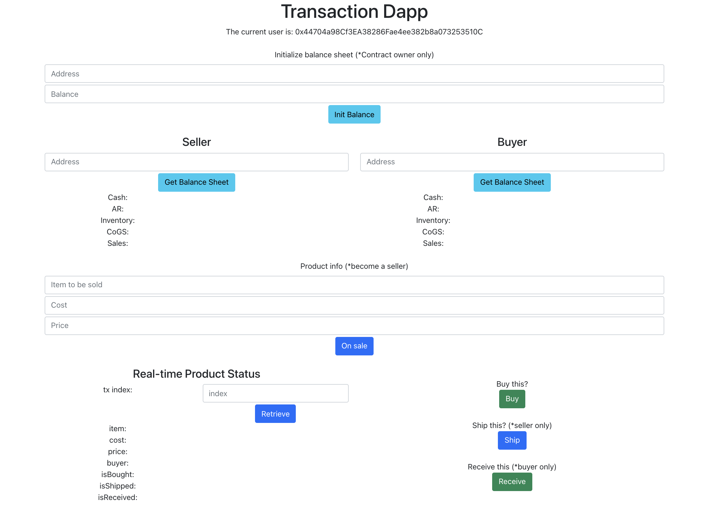

# transaction-dapp

> **Archived.** This research continues in
> [verifiable-teais](https://github.com/RayhungKao/verifiable-teais), which has the
> current contract, tests, and research notes.

First iteration (2022) of a blockchain-based triple-entry accounting information system: a
Solidity contract for a sales flow (sell, buy, ship, receive) that updates each party's accounts
on chain, with a React front end that connects through MetaMask.



The contract was deployed to Ropsten, which has since been shut down, so the deployed address and
the GitHub Pages front end no longer reach a contract.

## Known problems

Left in place as a record of this iteration:

- `seller` is one contract-wide variable that every `sell()` overwrites, so `ship()` and
  `receiveGood()` act for, and pay, whoever listed an item last.
- Accounts use `uint`. If the buyer's accounts were not initialised by the owner with enough cash,
  `receiveGood()` underflows and reverts, and the payment made in `buy()` stays locked in the
  contract.
- `initBalanceSheet()` sets every account to the same value and lets the owner overwrite anyone's
  accounts at any time. Cost of goods sold and sales are income statement accounts, not balance
  sheet accounts.
- Amounts are public on chain.

## Running the tests

```sh
npm install -g truffle
truffle test ./test/transaction.js
```

Deployment reads its secrets from the environment, never from `truffle-config.js`:

```sh
MNEMONIC="<12 words>" INFURA_PROJECT_ID="<id>" truffle migrate --network ropsten
```

Front end scripts are described in [client/README.md](client/README.md).
